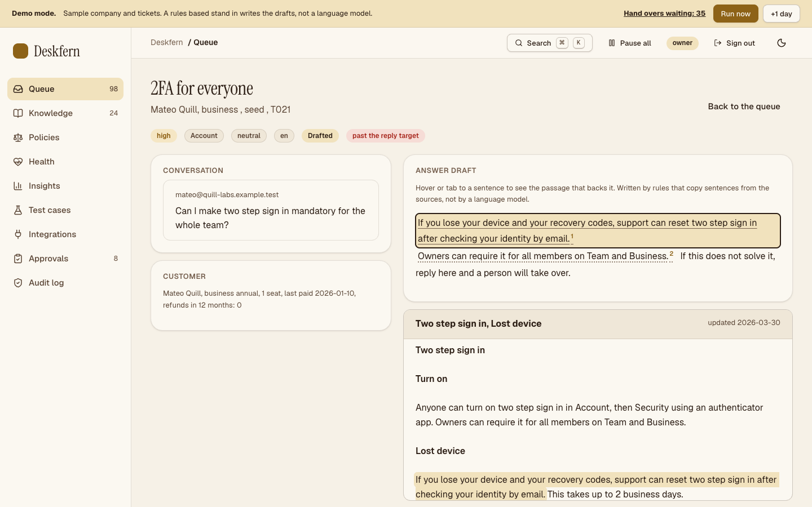

# Deskfern

A support desk that answers customer questions from your own help pages and shows the source of every sentence. Part of a set of seven free AI systems from Sendora. MIT licence.

- Reads your help pages, policies and past answers (a folder, Google Drive, Notion or a website).
- Answers a ticket with citations, scores every sentence against its sources, and hands over to a person when it is not sure.
- Refunds go through an approval. The person who asks cannot approve their own request, and a live install that can pay refunds needs a separate approver login. A refund approved while draft mode or Pause all is on is paid later, once, when both are off. Nothing is sent or paid in draft mode, and a reply held back that way leaves the ticket open.
- Turns an agent's edit into a test case, finds pages that are missing or disagree, and shows customer health.

## Try it with made up data

See `docs/01-QUICK-DEMO.md`. You need Python 3.12, Node 22.18 or newer and pnpm. No accounts, no keys, nothing leaves your computer.

## What was measured

All numbers come from `data/counts.json`, written by `tools/make_counts.py`.

| What | Result |
| --- | --- |
| Python tests | <!--n:tests.passed-->429<!--/n--> passed, <!--n:tests.skipped-->2<!--/n--> skipped, <!--n:tests.coverage_percent-->93.9<!--/n--> percent coverage |
| Browser tests | <!--n:e2e.tests-->38<!--/n--> tests (smoke, demo path, quality gates) |
| Pages | <!--n:pages-->10<!--/n--> |
| Screenshots | <!--n:screenshots-->35<!--/n--> at phone and desktop widths |
| Seed company | <!--n:seed.documents-->41<!--/n--> help documents, <!--n:seed.customers-->25<!--/n--> customers, <!--n:seed.tickets-->121<!--/n--> tickets |
| Held out questions | <!--n:heldout_questions-->63<!--/n--> written before the code |
| Model path tests | <!--n:model_path_tests-->33<!--/n--> against a local fake server, <!--n:llm_fixtures-->46<!--/n--> recorded fixtures (not a real model) |
| Contract tests | <!--n:contract_tests-->5<!--/n--> against saved public vendor doc excerpts |

## Read this before you trust it

The answer writer in this repo is a rule based stand in, not a language model. On the 63 held out questions it answered 13 correctly on the first run and over hands tickets to people. That is measured and shown in `docs/ANSWER-EVAL.md`. Two more test sets, written by people who never saw the code, are in `docs/INDEPENDENT-EVAL.md`: on the first run the desk read <!--n:independent.a_first.strict_right-->46<!--/n--> of <!--n:independent.a_first.tickets-->78<!--/n--> tickets right on set A and <!--n:independent.b_first.strict_right-->49<!--/n--> of <!--n:independent.b_first.tickets-->88<!--/n--> on set B. No real vendor service was contacted, and nothing was deployed to a real server. `docs/14-LIMITS-AND-HONEST-NOTES.md` lists everything that is unverified.

## Where to go

Start with `docs/00-START-HERE.md`. The tools it can connect to, with scored alternatives, are in `docs/TOOLS-AND-ALTERNATIVES.md`. Prompts for Claude Code and Codex are in `prompts/`. Security notes: `SECURITY.md`.
