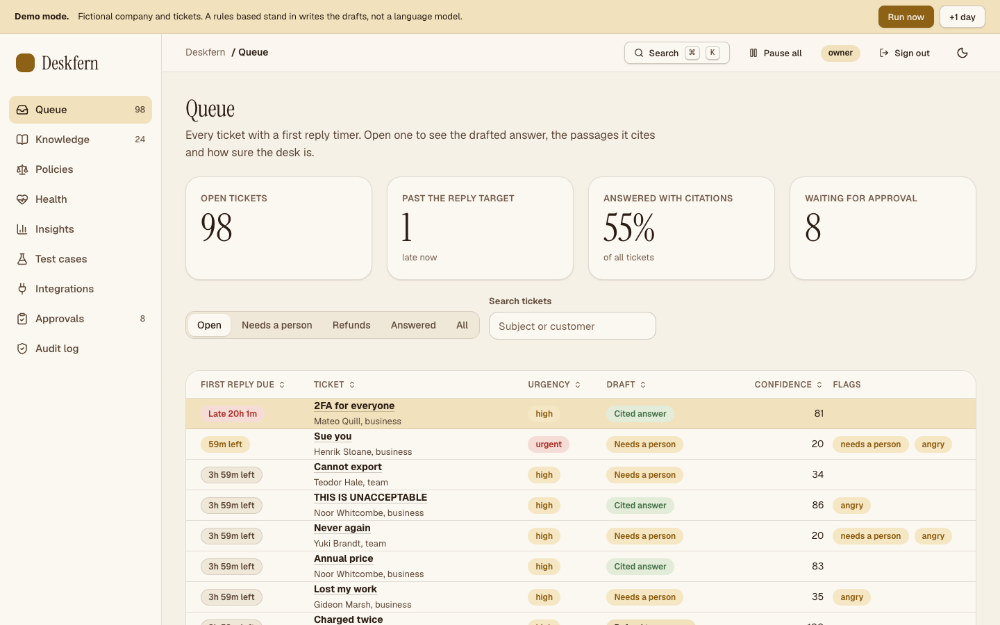
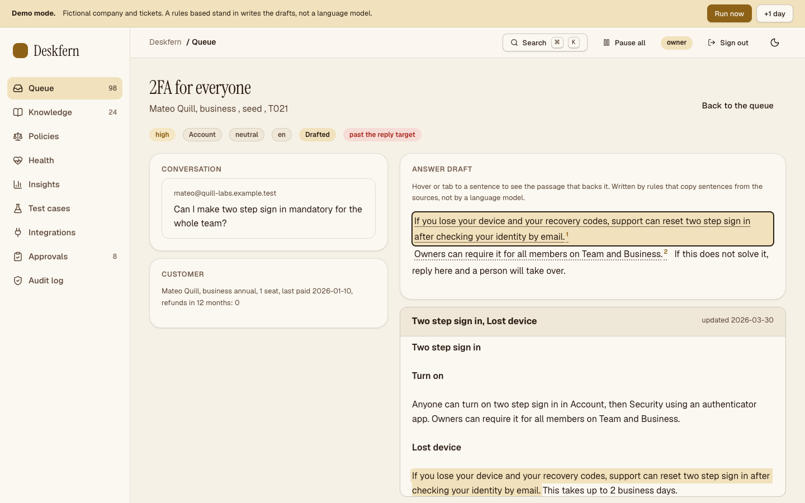
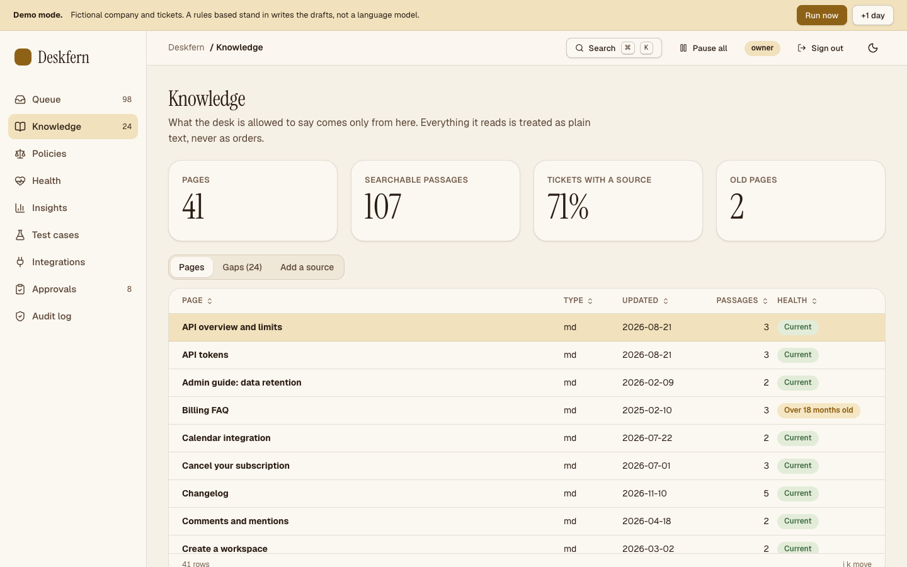
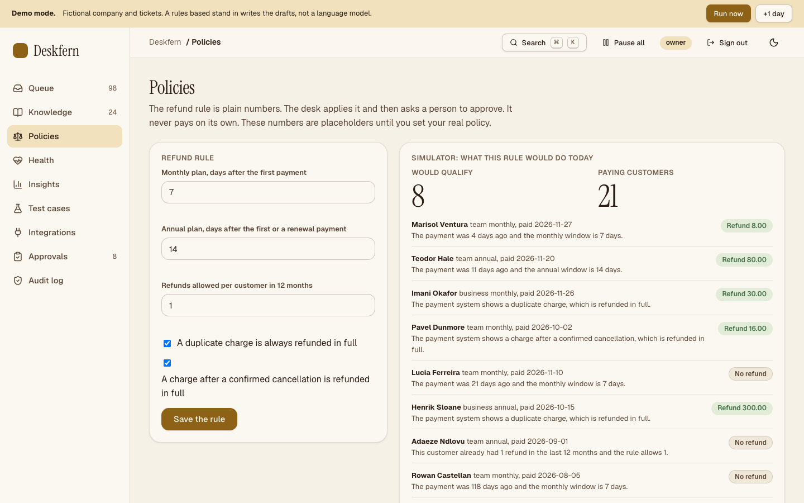
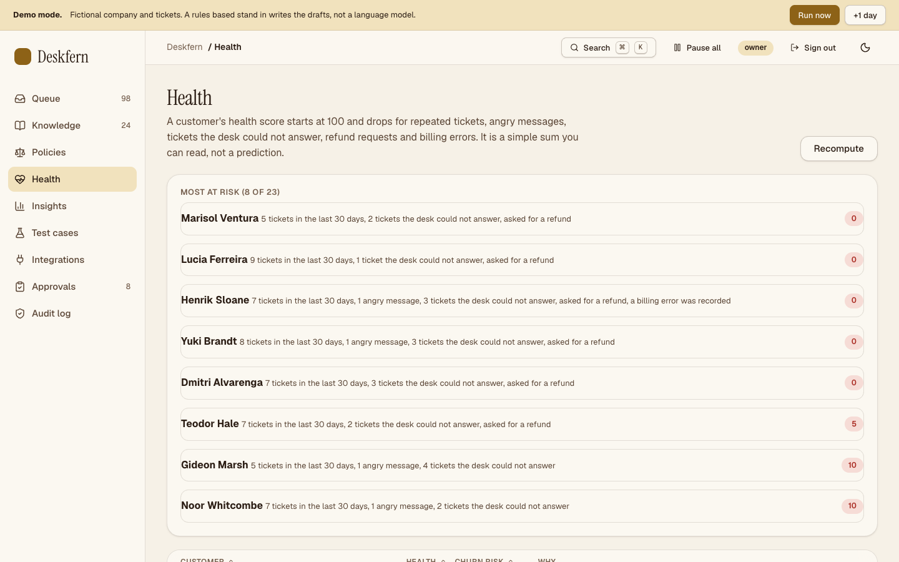
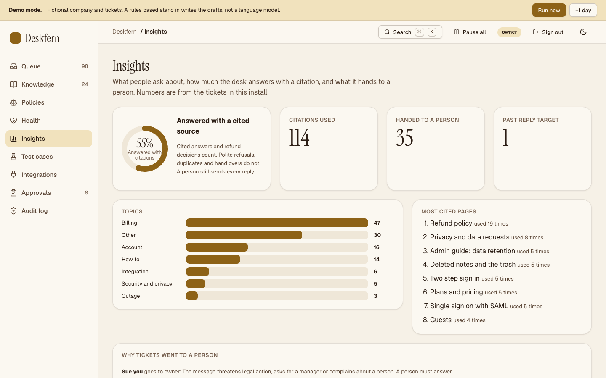
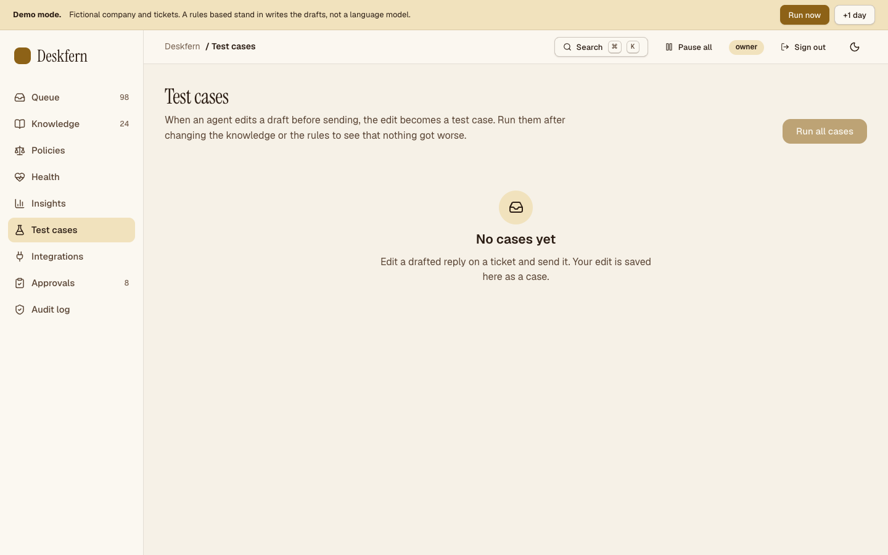
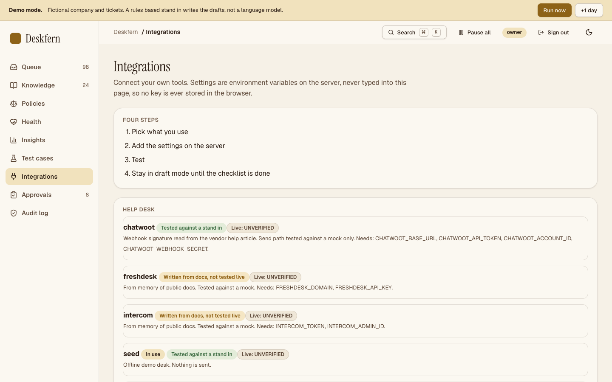
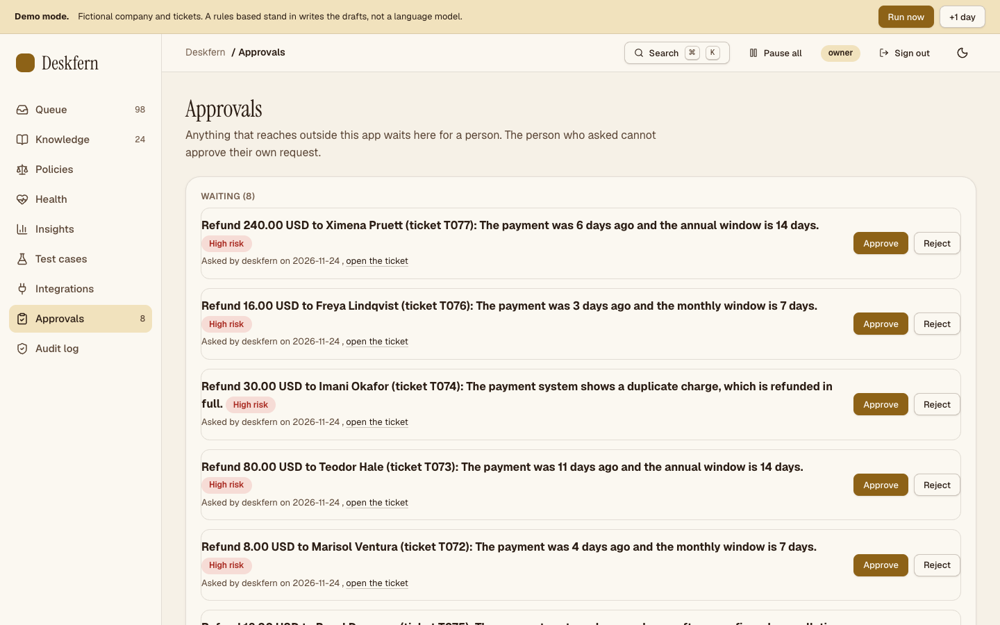
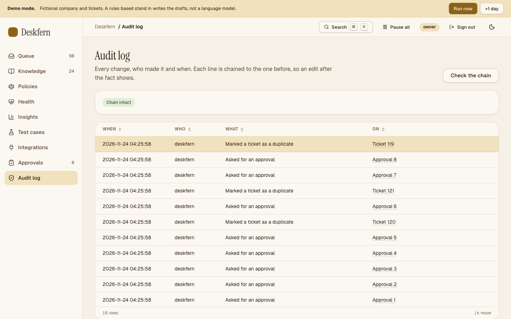

# Capabilities, with pictures

All pictures are of the demo with fictional data. Phone and desktop versions are in `docs/screenshots`.

| Page | What you can do | Picture |
| --- | --- | --- |
| Queue | Sort by reply deadline, filter, open a ticket |  |
| Ticket workspace | Read the cited draft, see each source, send, edit or hand over |  |
| Knowledge | Sources, sync, pages that disagree, gaps |  |
| Policies | Edit refund rules and try them in a simulator |  |
| Health | Customer health and churn hints |  |
| Insights | Volume, topics, gaps over time |  |
| Test cases | Saved agent edits, run them all |  |
| Integrations | Which tools are on, Test buttons, kill switch |  |
| Approvals | Decide waiting refunds (not your own) |  |
| Audit log | Every action, chained |  |

States captured at both widths: default, detail, warning (pages disagree), button while processing, toast, empty, error and dark. They are named `state-N-...` in the same folder.
